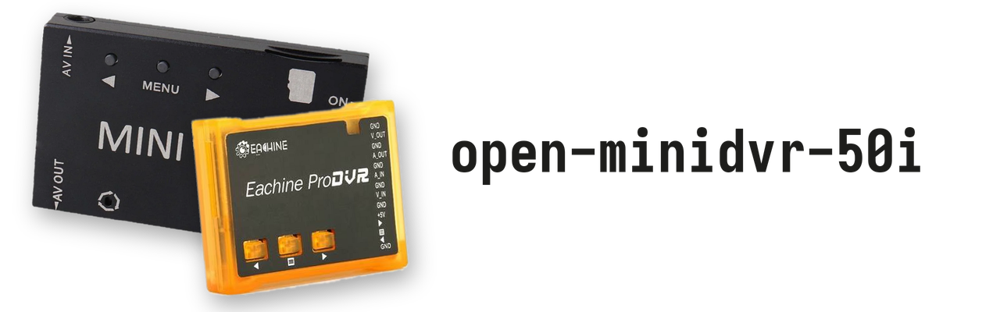

<p align="center">
  <picture>
    <source media="(prefers-color-scheme: dark)" srcset="docs/banner-dark.png">
    
  </picture>
</p>

**Better video and audio for a cheap FPV mini DVR.**

Custom firmware patches for the small FPV "mini DVR" sold as the **Eachine ProDVR** (and clones built on the same
board). It was reverse-engineered to record a Sony VX2100E (PAL) as well as this hardware allows.

| | Stock firmware | With this project |
|---|---|---|
| Video | one field per frame (288 lines) upscaled to 720×480 or 1280×720, 25 fps | **every field** (704×288 at 50 fields/s), woven into real **720×576 50i** on the PC, no scaling |
| Picture | 684 px window, cropped more on the left than the right, stretched to 720 wide | all 704 active pixels at 1:1, centred, finest JPEG quality from the start |
| Audio | 8 kHz mono, a click once per 32 KB block | **31 kHz** mono (real sound up to about 10 kHz), clicks removed by the converter |

> [!WARNING]
> **NTSC support is experimental and untested.** The patcher also offers an NTSC build for NTSC camcorders
> (704×240 fields at about 60 per second, converted to 720×480 29.97i). It has only been checked in an emulator and
> on simulated recordings, never on a real DVR with an NTSC camera. It may not work at all. It can't damage anything
> (same RAM boot as the PAL build), and reports are welcome. Details: [NTSC (experimental)](#ntsc-experimental).

**It doesn't touch your DVR's chip.** The patched firmware is loaded from the SD card into RAM at power-on. If you
switch off and start without the file, you're back to the stock firmware. Nothing to brick.

## Quick start (no programming needed)

1. **Make the files:** open the patcher page (<https://eonflux7.github.io/open-minidvr-50i/>, or `docs/index.html` offline) and follow the steps:
   - download Eachine's official ProDVR firmware (`CRESFW.BIN`)
   - pick your camera's standard: PAL, or NTSC (experimental, see above)
   - drop it on the page
   - save **ADJUST.BIN** and **UPOKE.BIN**

   The page runs entirely in your browser. It checks every byte it changes and refuses any other firmware version.
2. **Copy both files to the root of the microSD card** (not into a folder).
3. **Switch the DVR on and record in D1 mode.** Startup takes a little longer while it loads the file.
4. **Copy ADJUST.BIN again before every power-on.** The DVR deletes it when it loads it. UPOKE.BIN stays on the card.
   Once you're happy with it, you can [make it permanent](#making-it-permanent-sd-card-no-programmer) with the SD card alone.
5. **Convert the recordings on a PC** (next section). The raw files hold one field per frame and look squashed until
   they're converted.

### Converting recordings

You need [Python 3](https://www.python.org/downloads/) (tick "Add to PATH" when installing),
[ffmpeg](https://ffmpeg.org/download.html) on your PATH, and numpy:

```
pip install numpy
```

On Windows you can then drag an `.AVI` onto `tools/convert.bat`. Or run it yourself:

```
python tools/weave.py PICT0001.AVI PICT0001.mp4           # 720x576 interlaced (25i), for TVs and editing
python tools/weave.py PICT0001.AVI PICT0001.mp4 --bob     # 720x576 at 50p, smooth on computers and phones
python tools/weave.py PICT0001.AVI PICT0001.mov --prores  # ProRes 422 HQ + PCM audio, for editing
```

NTSC recordings (704×240) are recognised automatically and come out as 720×480 at 29.97i, or 59.94p with `--bob`.

The converter:
- pairs each top field with the next bottom field into a full frame (PAL: it tells them apart by the widescreen
  signal line; NTSC: from the picture itself, see below)
- skips stray fields
- hides the half-line and WSS rows at the edges
- removes the per-block audio click
- corrects the frame rate that the firmware writes into the file header (details below)

## Limitations (measured, not guessed)

- **Mono only.** The AV jack is TRRS, but the board feeds a single audio stream to the chip, and the firmware has no
  second input channel. Stereo would need board surgery plus an undocumented second ADC input. For stereo, record the
  camera's audio separately and sync it in post; the DVR's own track makes a good sync reference.
- **About 10 kHz audio bandwidth.** The roll-off sits at the same frequency whether the chip samples at 31 kHz or
  49.6 kHz, so it's an analog filter on the board (op-amp front end) plus the noise floor of the 12-bit ADC. Higher
  sample rates don't add real highs.
- **Audio rate tops out at about 31 kHz.** The chip can sample at 49.6 kHz, but then the firmware's SD writer falls
  behind after about 12 s and starts dropping video fields.
- **Rates come in steps.** The sample rate is 496000 / (77B2 + 77B3), so the options are 31000 Hz, 33067 Hz, 49600 Hz
  and so on. There's no exact 32 or 48 kHz. Players and editors handle 31 kHz fine.
- **Long recordings can stutter for a while.** Two long test recordings, one at stock 8 kHz audio, both had about 30 s
  of repeated fields around the 1:00–1:30 mark. The camera was moving and the cable may have been touched. The cause
  isn't settled. It's not the audio rate and not the picture content.
- **The raw AVI isn't directly watchable:** it holds 704×288 fields, and its header frame rate is wrong, because the
  firmware computes the frame rate from the amount of audio at a fixed 8 kHz. Always run the converter.
- **Only D1 mode was tested** with the 50i settings, and only with a PAL camera. VGA is stock, and HD records 1280×576.
- **The picture is JPEG at about 35–45 KB per field (about 2 MB/s).** It's a strip encoder with no frame memory, so
  true 576-line frames are impossible on this chip. That's why the project records fields.
- **ADJUST.BIN is one-shot.** The vendor bootloader deletes it after loading. To make the patch permanent, use the
  DVR's own SD updater (next section). Or, if you have a clip programmer, use `tools/flash.sh`.
- **One firmware only:** Eachine ProDVR firmware 2015.05.26.01.IR (CRESFW.BIN of September 2016). Other versions are
  refused.

## Making it permanent (SD card, no programmer)

The DVR has its own firmware updater: at power-on it looks for `CRESFW.BIN` in the card root and writes it into its
flash chip. That's how Eachine ships updates. Step 5 of the patcher page makes a patched `CRESFW.BIN`: exactly the
firmware you've been running as ADJUST.BIN, in the vendor's update format and at the same size. After the update the
DVR starts with it every time, and you no longer need ADJUST.BIN. Keep UPOKE.BIN on the card, because the settings
(50 fields/s, centring, quality, 31 kHz) still come from it.

> [!CAUTION]
> **This writes to the chip.** Try ADJUST.BIN first, with the same PAL/NTSC choice. If the power fails during the
> write, the DVR won't start and needs a clip programmer to recover. The updater is the vendor's, but it hasn't yet
> been run with this project's file. The NTSC build is untested even as ADJUST.BIN, so don't flash it until someone
> has recorded with it.

1. Charge the battery fully, or power the DVR over USB.
2. Copy `CRESFW.BIN` to the card root. **Remove ADJUST.BIN**, because if it's there the DVR loads that instead.
3. Switch on and leave the DVR alone while the red LED blinks. When it stops, wait about 30 s, then switch off.
4. Delete `CRESFW.BIN` from the card if it's still there. Otherwise the DVR writes it again at every start.
5. Record a short D1 clip with no ADJUST.BIN on the card. A raw file 704 pixels wide means it worked. Menu settings
   may return to their defaults.

**To undo:** do the same with Eachine's original `CRESFW.BIN`. The updater runs before any of this project's code (it's
called at bank10:8A5A, before the hook) and none of the patches touch it, so it works the same from the patched firmware.

From the shell: `python3 tools/mkrelease.py apply CRESFW.BIN /path/to/sdcard/CRESFW.BIN`. An output named CRESFW.BIN
gets the update format.

## NTSC (experimental)

**Untested on hardware.** Nobody has recorded with the NTSC build yet. What's known comes from the disassembly, the
emulator and simulated recordings.

- **Why there's a separate build:** the firmware itself detects NTSC (TVP5150 register 0x8C) and captures a 240-line
  field window. The PAL build fixes the D1 picture at 288 lines, so the JPEG scaler would stretch every NTSC field to
  288. The NTSC build is the PAL build plus one change: D1 is 704×240 (`tools/mkpatch.py` `ntsc_d1`, 31 bytes, checked
  in `tests/test_ntsc.py`).
- **Use it only with an NTSC camera.** A PAL camera on the NTSC build gets its 288-line fields squeezed to 240.
  The converter refuses NTSC recordings made with the PAL build and tells you to switch.
- **Field parity:** NTSC has no WSS line, so `weave.py` works it out from the picture. It compares each field with
  the previous one, shifted half a line up, half a line down and not at all, and picks the most likely top/bottom
  sequence for the whole clip. Checked against WSS on PAL recordings with the WSS rows cut off, it matched every field
  on clean clips (903 of 903). It can misjudge long stretches of repeated fields (like the stutter under Limitations)
  and very flat scenes. `--parity picture` runs the same method on a PAL recording, for comparison.
- **Unknowns:** whether the encoder keeps up at about 60 fields/s (the line rate is the same as PAL's, so it should),
  what the top and bottom rows contain (VBI, closed captions, half lines: the converter leaves them as recorded), and
  the HD mode (still 1280×576, stretched from 240 lines). The UPOKE.BIN settings don't depend on the standard.

If you try it, please open an issue with a short raw `.AVI` and what you saw on the DVR.

## How it works (short version)

- **CPU:** Syntek-class 8051 SoC (unbranded "D2EG19A1"), Keil C51 firmware, 16 banks of 32 KB, plus a TI TVP5150
  video decoder.
- **RAM boot:** the vendor bootloader loads `ADJUST.BIN` into RAM and runs it. Our image is the stock firmware plus:
  - a capture window of 704×288 at 1:1 in D1, with a higher bitrate target
  - a small **poke hook** that reads `UPOKE.BIN` and applies register writes at boot, at record start and every frame
    (it can also log registers into the AVI header for research, see `tools/poke.py` and `tools/plog.py`)
  - a 31 kHz audio header
- **50i:** the capture front end normally drops every second field. The hook's field gate keeps both, and the
  encoder gets each 288-line field as its own frame.
- **Tearing fix:** the higher bitrate made a band of stale picture appear at the bottom (stock doesn't show it). The
  JPEG encoder overtook the capture DMA while rate control started coarse. Starting at the finest level (`56E6 = 9`)
  removes it.
- **Audio:**
  - The record path hard-codes 8 kHz, and its byte-rate registers turned out to be bookkeeping only.
  - The real sample clock is the divider pair **77B2/77B3**: rate = 496000 / (77B2 + 77B3). Stock is 0x1F + 0x1F,
    which gives 8 kHz.
  - The pair is set from UPOKE.BIN.
  - Changing the neighbouring pair 77C0/77C1, or the firmware's internal rate variables, causes heavy field drops.

The full story, with register maps, addresses and every experiment, is in [docs/findings.md](docs/findings.md) and
the raw lab notebook [docs/lab-notes.md](docs/lab-notes.md).

## Repository layout

| Path | What |
|---|---|
| `docs/index.html` | browser patcher (the patch and UPOKE.BIN are embedded) |
| `docs/patch.json`, `docs/UPOKE.BIN` | release patch (byte runs with their original bytes, plus the extra `ntsc` runs) and the settings preset |
| `tools/weave.py`, `tools/convert.bat` | field-to-576i (PAL) / 480i (NTSC) converter |
| `tools/banner.py`, `docs/banner-*.png` | README banner (dark and light versions) |
| `tools/mkpatch.py` | all byte patches (named sets), verified against the original bytes |
| `tools/mkrelease.py` | builds `docs/patch.json` from a stock dump and the release build; also applies it from the shell |
| `tools/mkram.py` | flash image to ADJUST.BIN (RAM-boot image) |
| `tools/poke.py`, `tools/plog.py` | UPOKE.BIN compiler, and decoder for register logs stored in recordings |
| `hook/*.asm` | poke/logger hook sources (sdas8051); `.ihx` are the assembled outputs used by mkpatch |
| `pokes/*.txt` | every UPOKE experiment; `release_50i.txt` is the shipped preset |
| `tools/d51.py`, `tools/xref.py`, `tools/regcensus.py`, `ghidra/scripts/` | 8051 disassembler, cross-references, register census, Ghidra scripts for the banked image |
| `tools/emu51.py`, `tests/` | small 8051 emulator and tests for the hook and patches |
| `tools/flash.sh`, `tools/dvr.layout` | flashrom + pico-serprog flashing that keeps the menu-settings sector |

No vendor firmware, flash dumps or recordings are in this repository. `patch.json` holds only the bytes that are
changed, plus the original bytes at those places so the patch can be verified.

## Command-line use and development

To make ADJUST.BIN without the browser:

```
python3 tools/mkrelease.py apply CRESFW.BIN /path/to/sdcard/ADJUST.BIN   # or a 2 MB flash dump instead of CRESFW.BIN
python3 tools/mkrelease.py apply CRESFW.BIN /path/to/sdcard/ADJUST.BIN --ntsc   # NTSC build (experimental, untested)
python3 tools/mkrelease.py apply CRESFW.BIN /path/to/sdcard/CRESFW.BIN   # permanent install via the SD updater
python3 tools/poke.py pokes/release_50i.txt /path/to/sdcard/UPOKE.BIN
```

`tools/mkpatch.py` holds every patch set used during development. Each one is a list of (offset, original bytes, new
bytes) applied to a 2 MB flash dump and checked against the original bytes. `tools/mkram.py` turns a patched dump
into an ADJUST.BIN. The tests need local files that aren't in the repository: `tests/test_release.py` needs the peek6 build in
`patches/`, and `tests/test_hooks.py` needs a sample AVI header in `samples/`.

**Note on reproducibility:** the release is hook revision 6 (`clean704_q4_peek6` + `release_31k`). The sources in
`hook/` have moved on since then: more logger events, plus experimental edge-fix and wait modes that are off by
default. So rebuilding peek6 from today's sources won't match the tested binary byte for byte. `docs/patch.json`
*is* the exact tested build, regenerated with `tools/mkrelease.py json STOCK_DUMP RELEASE_BUILD CRESFW.BIN`.

## License

MIT (see [LICENSE](LICENSE)) for the code and documentation in this repository. The DVR firmware itself belongs to
its vendor and isn't included. Use at your own risk: the RAM-boot route doesn't write to the DVR's flash, but the
flashing tools do.
