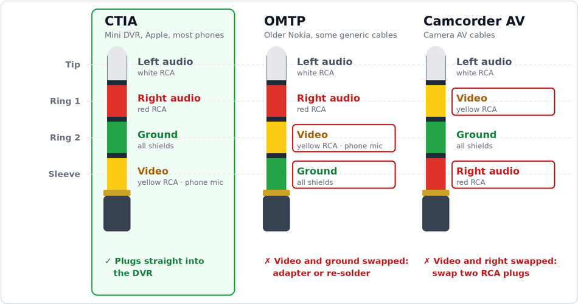
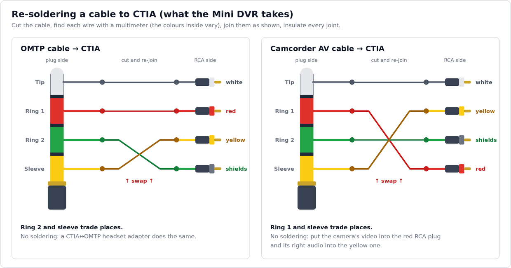

# Connecting the camera (AV cable)

The DVR's AV jacks are 3.5 mm TRRS (four contacts) and use the **CTIA** AV pinout: video on the sleeve, ground on
ring 2. Many generic 3.5 mm-to-RCA cables are wired differently, either **OMTP** (ground and video swapped) or the
**camcorder AV** pinout that many camera cables use (video and right audio swapped). With the wrong cable everything
looks plugged in, but there's no picture.

  <picture>
    <source media="(prefers-color-scheme: dark)" srcset="av-pinouts-dark.png">
    
  </picture>

- **CTIA cable:** works as it is: yellow plug to the camera's video out, white and red to its audio.
- **Camcorder AV cable:** ground is already in the right place, so swapping two plugs is enough. Put the camera's
  video into the cable's **red** plug and the camera's right audio into the **yellow** plug (white stays on left).
- **OMTP cable:** ground is on the wrong contact, and swapping RCA plugs can't fix that. Use a CTIA↔OMTP adapter
  (sold for headsets; it swaps ring 2 and the sleeve), or re-solder the cable to CTIA (below).
- **Not sure which one you have?** Set a multimeter to continuity and touch the 3.5 mm plug's sleeve (the metal part
  next to the handle). Then find which RCA plug's centre pin beeps: yellow means CTIA, red means camcorder AV. If none
  does and the sleeve beeps on the RCA shells instead, it's OMTP.

**Re-soldering a cable to CTIA:** cut the cable anywhere along its length. On the plug side, find which wire goes to
which contact with a multimeter. On the RCA side, find which wire goes to each plug's centre pin; the shields are the
ground. The colours of the wires inside vary from cable to cable, so don't go by them. Then join the wires so that
each contact gets the signal CTIA puts there, and insulate every joint (heat-shrink tubing is best):

  <picture>
    <source media="(prefers-color-scheme: dark)" srcset="av-rewire-dark.png">
    
  </picture>

The DVR records one audio channel (see [Limitations](limitations.md)). Which of left and right it
takes hasn't been measured yet, so connect both if your camera has both.
